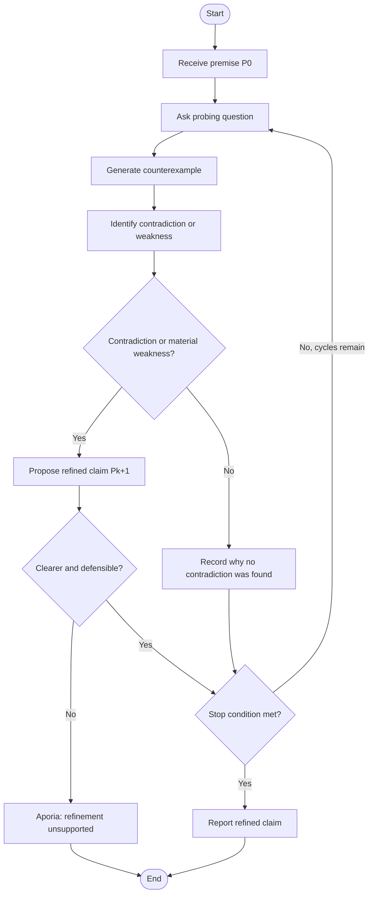

# 02 — Socratic Protocol Map

## Goal

Formalize the Socratic elenchus as a state machine. The initial premise is \(P_0\). If a contradiction or important weakness is identified, the engine attempts a refinement \(P_{k+1}\). It terminates when the claim is sufficiently refined, the model acknowledges **aporia**, or a maximum-cycle limit prevents an endless loop.

## State diagram



## State definitions

1. **INITIALIZE** — accept the premise and establish a cycle counter.
2. **PROBE** — ask one focused question about a definition, assumption, or implication.
3. **COUNTEREXAMPLE** — propose a relevant case that tests the premise's boundaries.
4. **ANALYZE** — describe a contradiction, weakness, or absence of a clear contradiction.
5. **REFINE** — propose a more precise claim that responds to the analysis.
6. **CHECK_TERMINATION** — stop if the claim is sufficiently precise, the model reports aporia, or the cycle limit is reached.
7. **APORIA** — record that the available reasoning or evidence does not justify a reliable refinement.
8. **TERMINATE** — return the trace and final status.

## Pseudocode

```text
input P0
claim = P0
trace = []
for cycle in 1..MAX_CYCLES:
    question = probe(claim)
    counterexample = test_boundary_case(claim, question)
    analysis = identify_conflict(claim, counterexample)
    result = refine_or_report_aporia(claim, analysis)
    append all steps to trace

    if result.status == "aporia":
        terminate with APORIA
    if result.status == "resolved":
        terminate with REFINED
    if result.refined_claim is empty or not meaningfully clearer:
        terminate with APORIA
    claim = result.refined_claim

terminate with MAX_CYCLES_REACHED and current claim
```

## Implemented JSON contract

Each cycle asks the LLM for a JSON object with these fields:

```json
{
  "question": "A focused probing question",
  "counterexample": "A relevant boundary case",
  "analysis": "What the example reveals",
  "contradiction_detected": true,
  "refined_claim": "A more precise claim, or an empty string",
  "status": "refine"
}
```

`status` should be `refine`, `resolved`, or `aporia`. The program validates the returned JSON structure enough to continue safely, but semantic validity still requires human review.

## Termination and safety controls

- A configurable maximum number of cycles prevents unbounded questioning.
- Aporia is a valid outcome, not a failure to sound confident.
- The final transcript retains intermediate steps for review.
- The LLM's contradiction label is treated as a hypothesis, not a mathematical proof.
- If a provider call fails, the program reports the error rather than fabricating a live response.

## Example premise

> An AI agent is benevolent if it obeys human commands.

Possible boundary case: a person asks an AI to reveal another person's private data. Obedience alone does not establish benevolence because the request may harm another person. A possible refinement is that helpfulness requires considering legitimate authority, consent, foreseeable harm, and applicable safety constraints. This is an illustrative philosophical example, not a universal formal definition.
